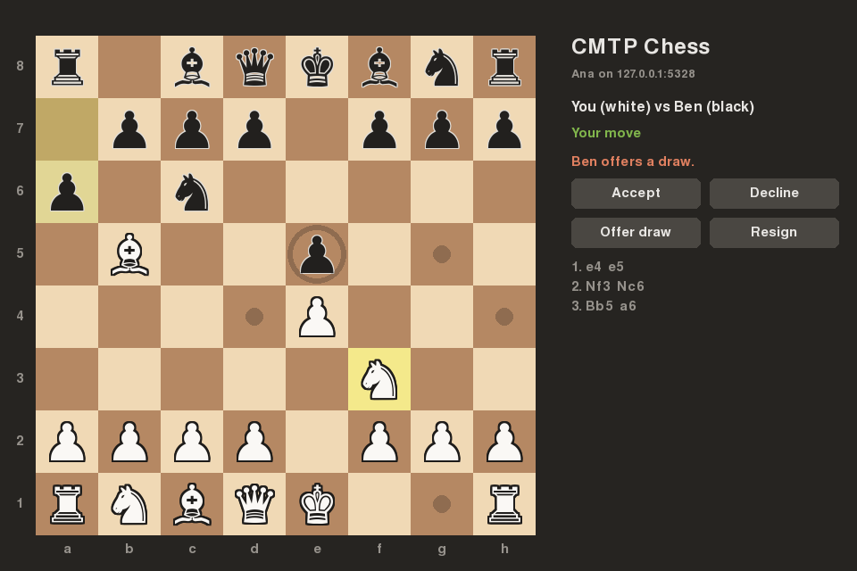

# CMTP: Client-Server Protocol for Multiplayer Chess

A custom application-layer protocol (CMTP) for two players to play chess through a central
server, plus a chess rules engine written from scratch.



## Setup

Requires Python 3.12 or newer.

```bash
python3 -m venv .venv
.venv/bin/pip install -e ".[dev]"
```

## Running the server

```bash
.venv/bin/python -m server
```

It listens on port 5328 on all network interfaces. Options:

- `--port N`: listen on a different port.
- `--host ADDRESS`: listen on one address only, such as `127.0.0.1`.
- `--max-clients N`: turn away connections past this many (default 1000).
- `-v` / `--verbose`: log every message sent and received.

Stop it with Ctrl-C. Connected clients are told the server is shutting down (error 502) before they're disconnected.

## Playing with the text client

Start the server, then run a client in each of two more terminals:

```bash
.venv/bin/python -m client --name Ana
```

Use `--host` to connect to a server on another computer, and `--unicode` to draw pieces as chess symbols.
One player types `create`, the other types `list` and then `join g1`. Moves can be typed in SAN (`e4`, `Nf3`,
`O-O`, `e8=Q`) or UCI (`e2e4`). Type `help` for every command, including `draw`, `resign`, `ping`
(round-trip time to the server), and `raw` (send any protocol message, for testing the server).

## Playing with the graphical client

The GUI needs pygame-ce:

```bash
.venv/bin/pip install -e ".[gui]"
```

Then, with the server running:

```bash
.venv/bin/python -m client.gui --name Ana
```

Leave out `--name` to type it in the window. Click one of your pieces to see where it can go, then click a
square to move. The panel on the right lists open games (refreshed every 2 seconds) and has buttons for
creating a game, offering or answering a draw, and resigning (click twice to confirm).

## Dropped connections

Clients send a heartbeat `PING` every 10 seconds. If a connection drops mid-game without the client saying
`BYE`, the server holds the player's seat for 60 seconds, and the client reconnects and resumes by itself.
For a quicker demo, shorten both on the server:

```bash
.venv/bin/python -m server --idle-timeout 10 --resume-window 20
```

## Testing tools

The chaos proxy sits between clients and the server and mangles the traffic: it splits it into tiny pieces,
delays them, and can cut connections. Start it in front of a running server, then point a client at its
port (6328) instead of the server's:

```bash
.venv/bin/python -m tools.chaos_proxy --target-port 5328 --max-chunk 1 --max-delay 0.01
```

Stopping and restarting the proxy mid-game shows a client resuming after a network outage.

Bots play random legal moves against each other and report how long each move took to be confirmed:

```bash
.venv/bin/python -m tools.bot --games 4
```

## Protocol specification

[docs/protocol-spec.md](docs/protocol-spec.md) defines CMTP version 1: framing, every message, the
error codes, heartbeats, resuming, and security considerations. `tests/test_spec.py` checks that
its examples and tables match the code.

## Measuring performance

The load test starts its own server and plays many bot games at once, measuring latency under load,
the server's throughput limit, and the effect of network delay. The benchmarks time the rules engine
and the size of each message. The charts tool draws all of it as SVG and PNG:

```bash
.venv/bin/pip install -e ".[report]"
.venv/bin/python -m tools.benchmarks --out docs/measurements
.venv/bin/python -m tools.load_test --games 1 10 100 250 500 --think 1 --max-plies 30 --out docs/measurements/scaling
.venv/bin/python -m tools.load_test --games 1 10 25 50 100 200 400 --think 0 --max-plies 60 --out docs/measurements/throughput
.venv/bin/python -m tools.load_test --games 4 --latency 0 0.05 0.1 0.2 --think 0 --max-plies 40 --out docs/measurements/latency
.venv/bin/python -m tools.charts docs/measurements
```

To measure across a LAN, run a server on another computer and point bots at it:
`.venv/bin/python -m tools.bot --host <address> --games 10`.

## Running the tests

```bash
.venv/bin/pytest
```

Deep perft runs (millions of positions, about 40 seconds in total) are skipped by default. To include them:

```bash
.venv/bin/pytest --runslow
```

## Rules engine

`src/chessrules` implements every rule of chess with no chess library: castling, en passant,
promotion, check, checkmate, stalemate, insufficient material, the fifty-move rule, and
threefold repetition. It reads and writes FEN, takes moves as UCI text (`e2e4`, `e7e8q`), and
writes them as SAN (`Nf3`, `exd5`, `O-O`).

```python
from chessrules import ChessGame

game = ChessGame()
for move in ["f2f3", "e7e5", "g2g4", "d8h4"]:
    played = game.play(move)
    print(played.san)        # f3, e5, g4, Qh4#
print(game.outcome)          # Outcome(result='0-1', reason='checkmate')
```

Move generation is checked with perft against the published counts for the standard test positions.

## Protocol library

`src/cmtp` is the wire format both sides share. Each message is a JSON object inside a
length-prefixed frame (a 4-byte big-endian length, then the payload). Messages are checked
against a strict schema on both sending and receiving.

```python
from cmtp import FrameReader, Message, MessageType, Sender, decode, frame_message

wire = frame_message(Message(MessageType.MOVE, seq=1, body={"game_id": "g42", "ply": 0, "move": "e2e4"}))

reader = FrameReader()                  # buffers bytes until whole frames arrive
for payload in reader.feed(wire):
    message = decode(payload, sender=Sender.CLIENT)
    print(message.type, message.body)   # MOVE {'game_id': 'g42', 'ply': 0, 'move': 'e2e4'}
```
